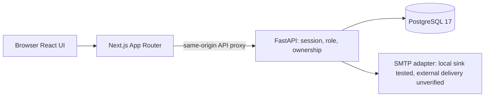

# GridWatch BD

Built with **Next.js App Router, React, TypeScript/JavaScript, Tailwind CSS/DaisyUI, FastAPI and PostgreSQL**.

A Bengali-first website for announced power interruptions, personal connection reports and activity planning. The normal site uses persisted PostgreSQL records, excludes fictional evidence and provides responsive Bengali navigation, help and privacy pages. The supplied source directory is integrated: 428 portal-listed administrative records and a separate 5,765-record Census 2022 reference branch. 419 portal records matched original sources; nine remain under review. The historical extraction is not a current-boundary crosswalk. No official live outage feed, feeder mapping or public deployment has been verified. Missing power evidence stays unknown.

**Windows: use `START-WEBSITE.cmd` for the normal website at http://localhost:5173.** It starts Docker, checks the normal database schema and launches API/frontend without adding sample electricity records or accounts; an empty administrative directory receives the reviewed real Sylhet catalog. Existing normal users and settings are preserved; old isolated demo accounts do not become real accounts. [Exact startup, Admin setup and publishing prerequisites](docs/WEBSITE.md).

- [Latest release checks, fixed defects and hosting prerequisites](docs/FINAL-RELEASE-REVIEW.md)
- [Scope, sources, user flows and data rules](docs/SCOPE.md)
- [Progress and seven-day work sequence](docs/PROGRESS.md)
- [Sections 5–6 implementation and API guide](docs/SECTIONS-5-6.md)
- [Sections 7–8 dashboard, saved preferences and freshness guide](docs/SECTIONS-7-8.md)
- [Database design](docs/DATABASE.md)
- [Sections 3–4 API, security, email and testing guide](docs/AUTH-LOCATIONS.md)
- [Selected Vercel/Render deployment and operations](docs/DEPLOYMENT.md)
- [Owner dashboard setup](docs/DASHBOARD_SETUP.md)
- [Data sources and evidence limits](docs/DATA_SOURCES.md)
- [Submission acceptance and repository links](docs/SUBMISSION.md)
- [Presentation/viva/local fallback](docs/DEMO_SCRIPT.md)
- [Supplied SQLite integration, migration and limitations](docs/SUPPLIED-DIRECTORY.md)
- [Area search repair and original-source catalog](docs/AREA-SEARCH-REVIEW.md)
- [Normal public website, UI and startup verification](docs/PUBLIC-WEBSITE-REVIEW.md)
- [Full application review, fixes and remaining gates (2026-11-04)](docs/FULL-REVIEW-2026-11-04.md)
- [Populated local demo: one launcher, private accounts and data](docs/LOCAL-DEMO.md)

The historical `START-DEMO.cmd` is retained only for isolated developer/testing walkthroughs. It is **not** the normal website launcher and must not be used for a public release.

## Repository and architecture

[Frontend](https://github.com/husainxdev/Gridwatch-BD/tree/main/frontend) · [Backend](https://github.com/husainxdev/Gridwatch-BD/tree/main/backend). This remains one authorized monorepo; visibility/ownership were not changed.



No verified frontend/backend live URL is available. The selected future path is Vercel + Render API + persistent Render PostgreSQL; this is **prepared, not deployed**. See [release status](docs/RELEASE-STATUS.md).

## Local requirements and setup

Node.js 22.12+ (tested with 24), npm, Python 3.12+, uv, Docker and Docker Compose. Ports 5432, 8000, 5173, 1025 and 8025 must be available.

```bash
# From repository root. Generates local-only random database and JWT secrets
# if both .env files are absent. Never overwrites existing configuration.
bash scripts/setup.sh
```

The script installs frozen dependencies, starts PostgreSQL and Mailpit, applies migrations and builds the frontend. It does not run a seed or create default accounts. Existing legacy sample-table rows, if any, are preserved and unavailable on the normal site. Root, backend and frontend `.env.example` files describe the variables. `.env` values are ignored by Git. If you already have one `.env` file, finish configuring the other from its example; the initializer intentionally refuses partial configuration.

Run the API and web application in separate terminals:

```bash
cd backend
.venv/bin/uvicorn app.main:app --host 0.0.0.0 --port 8000 --reload
```

```bash
npm run dev --prefix frontend
```

Visit the local Next.js server at `http://localhost:5173`. Next.js proxies `/api` to the API on port 8000. Mailpit's local development mailbox is on port 8025. It catches password-reset email locally; no external email is sent in this configuration. Do not expose Mailpit publicly.

Create your own local administrator through a password prompt (no default admin credentials are committed):

```bash
backend/.venv/bin/python scripts/create-admin.py
```

Any user may register in the app. The new admin can add a location hierarchy, attach source URLs, mark an area and a notice verified, and create a schedule or a verified outage event. For practice, use the separate populated demo workflow; never enter fictional notices as verified facts in the normal pilot database. The bundled catalog supplies a verified administrative starting point. Verify actual provider/coverage and original notices separately before publishing electricity facts, as described in [SCOPE.md](docs/SCOPE.md). Demo fixtures never appear in the operational dashboard.

## What works

- Email registration and login with bcrypt password hashing, 15-minute JWT access tokens, seven-day rotating hashed refresh sessions, replay-family revocation, logout, CSRF checks and password-reset email through configured SMTP. Server-side role checks protect admin APIs. There is no preloaded admin account.
- Configurable urban/rural location tree, verification evidence, saved areas, and an Admin/User dashboard.
- Admin location and notice CRUD with verified-source review; schedule CRUD, cancellation, search/filter/sort/page APIs; read-only public notice browsing.
- Per-connection power-off, power-back and still-off reports, request-key idempotency and a ten-minute duplicate cooldown.
- Separately reviewed outage events requiring restoration evidence, recent reports, recorded history, and activity overlap checks against announced schedules.
- Bengali-first responsive public interface, mobile menu, help/privacy pages, accessible forms, source links, unknown/loading/error/stale/empty states; fictional warnings exist only in explicitly isolated developer environments.

Public API docs are available locally at `/docs`. Unverified notice entries are labeled. Source URLs are administrator input, not independently authenticated by the software. A report does not determine area-wide status; no reports is **unknown**, and a scheduled end does not close an actual event.

## Tests and checks

```bash
# Creates and drops an isolated migrated PostgreSQL database; safe for local development
python3 scripts/test.py
backend/.venv/bin/ruff check backend scripts
backend/.venv/bin/ruff format --check backend scripts
backend/.venv/bin/python scripts/validate-release-config.py
npm run check:release --prefix frontend
npm run lint --prefix frontend
npm run format:check --prefix frontend
npm run build --prefix frontend
backend/.venv/bin/python scripts/browser-test.py
curl --fail http://127.0.0.1:8000/api/health/live
curl --fail http://127.0.0.1:8000/api/health/ready
```

`python3 scripts/test.py` needs a running local Compose database and a backend `.env` generated by setup. Integration tests exercise auth, permissions, source verification gates, schedule conflicts, duplicate reports, restoration evidence, refresh replay, logout and reset. Readiness checks connectivity and schema revision; liveness checks the process. The initial migration was also tested through an upgrade/downgrade/upgrade round trip on a disposable database.

Windows PowerShell startup is covered in [the Next.js guide](docs/NEXTJS.md). Use `npm.cmd` in PowerShell; keep API and frontend terminals open. Existing private `.env` files and a working custom PostgreSQL port (e.g. 15432) must be preserved. The [private local demo procedure](docs/DEMO_SCRIPT.md) creates a new isolated DB and never resets normal records.

## Deployment boundary

The source can be built and run with a hosted PostgreSQL database and a Next.js Node server, with prepared provider settings, but hosting configuration/access and actual URLs are still pending; no public deployment is live-verified. Set a strong `JWT_SECRET`, real `DATABASE_URL`, `APP_ENV=production`, `DEMO_ENABLED=false`, explicit `CORS_ORIGINS` and `FRONTEND_URL`, a trusted SMTP service, HTTPS, migrations and a running Next.js server and same-origin `/api` routing. Browser requests always use same-origin `/api`. Set `GRIDWATCH_API_TARGET` at build time for the Next.js rewrite when changing the upstream; never put secrets in `NEXT_PUBLIC_*` variables. Production refresh cookies are `Secure`, HttpOnly, and SameSite Strict; host frontend and API under the same site. Add backups, monitoring, rate limiting at the ingress, and security review before public exposure. No official API access is required for a manual pilot.

Stop local services with `docker compose stop db mail`; volumes persist. The cloud checkout is already isolated; no extra Git worktree is needed.

Sections 9–10: [Admin workspace, saved activities and personal history](docs/SECTIONS-9-10.md), including Windows PowerShell startup and migrations 0005–0006.

[Next.js migration and Windows update guide](docs/NEXTJS.md).

[Implementation review and remaining limits (2026-10-29)](docs/REVIEW-2026-10-29.md).

[Sections 11–12 verification matrix, QA findings and remaining prerequisites](docs/QA-SECTIONS-11-12.md).
