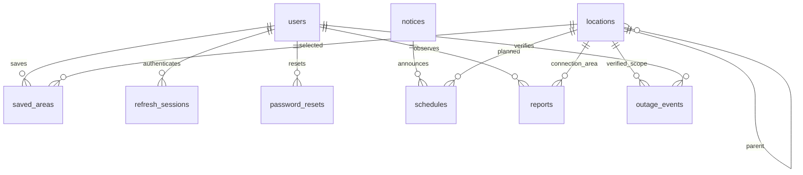

# Storage model

`demo_areas` deliberately has no relation to operational tables. UUID primary keys, foreign keys, uniqueness, indexed references and timezone-aware timestamps are used throughout. User/schedule/report states use database CHECK constraints. Delete restrictions preserve outage evidence; deleting accounts in a future service should deactivate/anonymize rather than erase event provenance.

The initial migration contains explicit table/index/constraint operations and does not import mutable application models. Alembic is the schema authority; the application never calls `create_all`. Readiness checks database connectivity and migration revision. Update the readiness revision contract when adding migrations.

Remaining service invariants: normalize emails, verify source URL safety, reject blank evidence, enforce admin reviewer permissions, validate location parent types/cycles, ensure end-user observation timestamps are plausible, prevent cross-area evidence misuse, implement cooldown/refresh rotation/reset semantics. API services implement the location parent rules, cycle checks, admin gate, request idempotency and event evidence requirements. Ingress rate limiting and independent source review remain before public deployment.

Migration `0002` adds normalized email/location unique indexes, searchable aliases and refresh-token replacement links. PostgreSQL 15+ is required (local Compose uses 17). See [auth and location invariants](AUTH-LOCATIONS.md) for implemented transactions, parent rules and session semantics. Existing normalized duplicates must be reviewed before migration; they are never silently removed.

## Source directory — migration 0007

`directory_datasets` retains the supplied file checksum, all 19 source links, the operator's independent review manifest and ancillary review/utility notes. `directory_places` keeps portal and census2022 snapshots in separate branches, preserving original IDs, parent links, names, BBS code segments and claimed PDF pages. Census rows are constrained to have no active `location_id`; they cannot become report targets. Portal entries may link to reused/current Location IDs.

`locations.name_en` is now nullable because 379 supplied portal records have no English label. No translation or placeholder is manufactured. The English-name uniqueness index remains case/whitespace normalized and unique for non-null labels; the Bangla/parent/type constraint remains unchanged. Stable listing order falls back to Bangla names. Migration 0007 preserves existing account/session/location/report data. Downgrade refuses to erase directory records or manufacture missing English names.

Imports are checksum-bound, idempotent, transactional and use the same advisory locks as Admin hierarchy mutations. Existing Location names, review states, versions and timestamps are preserved. Source snapshots remain immutable provenance; live Admin verification still determines whether a linked portal entry can be used for reporting. [Import/API details](SUPPLIED-DIRECTORY.md).
