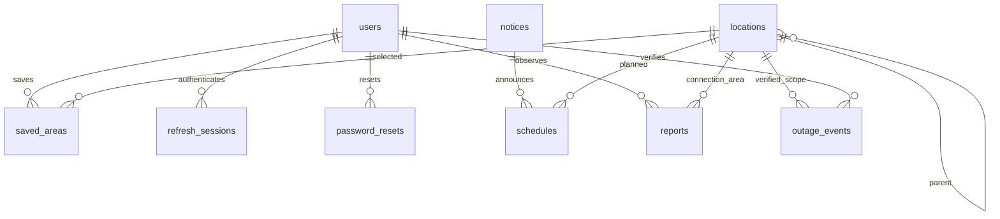

# Storage model

`demo_areas` deliberately has no relation to operational tables. UUID primary keys, foreign keys, uniqueness, indexed references and timezone-aware timestamps are used throughout. User/schedule/report states use database CHECK constraints. Delete restrictions preserve outage evidence; deleting accounts in a future service should deactivate/anonymize rather than erase event provenance.

The initial migration contains explicit table/index/constraint operations and does not import mutable application models. Alembic is the schema authority; the application never calls `create_all`. Readiness checks database connectivity and migration revision. Update the readiness revision contract when adding migrations.

Remaining service invariants: normalize emails, verify source URL safety, reject blank evidence, enforce admin reviewer permissions, validate location parent types/cycles, ensure end-user observation timestamps are plausible, prevent cross-area evidence misuse, implement cooldown/refresh rotation/reset semantics. API services implement the location parent rules, cycle checks, admin gate, request idempotency and event evidence requirements. Ingress rate limiting and independent source review remain before public deployment.
