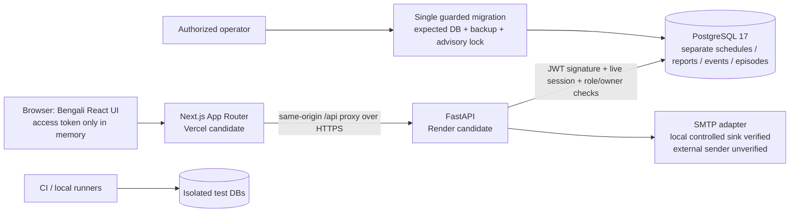

# Presentation guide and private local fallback

This is an engineering-prepared script, not a measured presentation or invented user study. Aim for about 5–7 minutes; adapt to the evaluator. No hosted URL exists yet. Use the real app and explicitly labeled practice data; never describe fictional reports as actual Sylhet outages.

## Suggested walkthrough (about 6 minutes)

| Approximate slot | Demonstration and accurate explanation |
| --- | --- |
| 0:00–0:40 | “People need to distinguish an announced interruption from their own connection status. GridWatch BD stores these as separate evidence.” State that real pilot sources/live deployment are not yet verified. |
| 0:40–1:20 | Log in as the private demo User; search a prepared **fictional demo** location, save/default it and reload. Saving, temporary viewing and default selection are separate. |
| 1:20–2:00 | Read a prepared practice announcement, its named coverage, source/review status and publication/update times. There is no real official notice loaded: this demonstrates the workflow, not government confirmation. A real notice must be checked against its original source before a real pilot. |
| 2:00–3:00 | Report off → still off → back. If two private demo Users are available, restore one while leaving the other open. Explain idempotency/retry and that one household does not determine an entire area's status. |
| 3:00–3:45 | Save a meeting/exam whose interval overlaps the announced practice schedule. Show the clipped overlap/source and uncertainty. Mention the exact-boundary rule and union calculation. |
| 3:45–4:20 | Open personal history: completed/open/incomplete records, known minutes and daily split. Explain that missing reports are unknown, not zero measured downtime. |
| 4:20–5:15 | Switch to the private demo Admin. Show draft/source review/publication, revision/cancellation and a reasoned moderation/audit entry. Closing a broader event never restores every user's episode. |
| 5:15–6:20 | Show architecture, JWT/session/role boundaries and the verified local checks. Clearly state missing hosted verification, external SMTP and real Sylhet source data. |

Before presenting, prepare only clearly labeled practice records through the real Admin UI in the isolated demo DB. No operational notices/reports are automatically fabricated by the local setup. The two home sample areas are separate demo-table rows. For an official-looking step say “practice announcement workflow”; do not invent an official citation. Have the exact source document ready if a real source is later verified.

## Architecture actually implemented



The hosting boxes are the **selected path, not live deployed services**. Current local execution uses Next.js and Uvicorn on loopback with Docker PostgreSQL. The frontend has explicit Next routes rather than Vite/React Router fallback. The backend does not fetch arbitrary source URLs and no uploads/official API are implemented.

## Likely viva questions (code-based answers)

1. **Why separate schedules, reports and events?** A planned window is an announcement; a report is one connection's observation; a reviewed event has explicit evidence. See `models.py`, `evidence.py` and `dashboard.py`.
2. **What is inside a JWT?** Signed HS256 claims include user/session identifiers, type and expiry; no password or refresh token. Access lasts 15 minutes. Backend also checks the active DB user/session, so frontend hiding a route is insufficient.
3. **How can logout revoke a JWT immediately?** The JWT's session ID is checked against the database on protected requests. Logout revokes that session and clears its matching cookie; replayed/revoked sessions fail.
4. **How do refresh/reset tokens differ?** Random refresh tokens are hashed and rotated in families with strict reuse revocation; seven-day rolling lifetime. Reset tokens are hashed, expire after 20 minutes, are atomically single-use and revoke prior sessions. Reset does not auto-login.
5. **Why memory + HttpOnly cookies?** Access stays in memory. Refresh is HttpOnly/Secure in production; same-origin proxy, exact Origin and double-submit CSRF protect cookie operations. No auth tokens in local/sessionStorage. A same-origin XSS still matters, so notes/titles are rendered as text and sources restrict protocols.
6. **Why bcrypt's byte rule?** Passwords must be 8–72 UTF-8 bytes; Bengali characters may use multiple bytes. Input is rejected instead of silently truncated.
7. **How are locations modeled?** Typed parent links allow urban/rural branches; a city corporation is not an upazila. Cycles, invalid subtrees and normalized duplicates are rejected. Electricity claims are separate from administrative boundaries.
8. **How is overlap calculated?** Half-open: `activity_start < schedule_end && activity_end > schedule_start`. 14:00–15:00 plus 14:30–15:30 has a 90-minute union. Starting at 15:30 creates no overlap with an announcement ending at 15:30.
9. **Why use Asia/Dhaka?** Storage is timezone-aware/UTC; presentation and daily boundaries use Bangladesh time. 23:50–00:20 splits 10 minutes/20 minutes. Unknown/open durations do not enter completed averages.
10. **What prevents duplicate or cross-user history?** Per-user transactional locks, request keys and DB constraints; ownership comes from authenticated identity, never a client user_id. Repeated confirmations preserve the original episode; moderation keeps original observations/audit.
11. **What do the tests prove?** Real local PostgreSQL journeys, roles, races, math, migrations, SMTP sink and rendered accessibility/layout checks. They do not prove real electricity coverage, provider uptime, external email delivery or live browser cookie behavior on a host that was never deployed.
12. **How do you release/rollback safely?** Frozen locks, exact source identity, one expected-target/backup-gated migration step, private backups restored into a fresh DB, then live checks. App rollback does not undo migrations.
13. **Is it offline/live monitoring?** No. Polling can show explicitly stale evidence; missing observations are unknown. Pending retry state is memory-only, not a durable offline queue. No reminder delivery, official feed, SAIDI/SAIFI or invented confidence percentages.

## Local fallback — no hosting/internet required after dependencies are installed

Run from **PowerShell** on the owner's machine. Docker Desktop must show Engine running. Keep the existing normal `.env`/database; the creator makes a new marked database and never resets it.

```powershell
cd "$env:USERPROFILE\Gridwatch-BD"
docker compose up -d --wait db
.\backend\.venv\Scripts\python.exe scripts/create-local-demo.py
```

Credentials/config are written only to `.private\local-demo\` (not GitHub). Read the credentials privately before presenting; do not show that file on the projector or print it in logs. To reset practice data, create a new isolated namespace/directory instead:

```powershell
.\backend\.venv\Scripts\python.exe scripts/create-local-demo.py --private-directory .private/demo-2
```

Use the matching directory in commands below. This preserves the old demo and all normal/production records. Retire only the specifically identified disposable DB later through an authorized maintenance procedure.

Backend terminal:

```powershell
cd "$env:USERPROFILE\Gridwatch-BD"
.\backend\.venv\Scripts\python.exe -m uvicorn app.main:app --app-dir backend --env-file .private/local-demo/backend.env --host 127.0.0.1 --port 8001
```

Separate frontend terminal:

```powershell
cd "$env:USERPROFILE\Gridwatch-BD"
$env:GRIDWATCH_API_TARGET="http://127.0.0.1:8001"
$env:NEXT_PUBLIC_DEMO_INSTANCE="true"
npm.cmd run dev --prefix frontend -- --hostname 127.0.0.1 --port 5174
```

Open **http://127.0.0.1:5174** in a separate browser profile/incognito window. This is a **local fallback**, not a verified live URL. Using 127.0.0.1 instead of normal localhost also avoids host-cookie collision with a normal localhost development session. Do not run two Next development servers for the same build directory simultaneously; stop the normal frontend first. Keep both terminals open. These development settings must never be publicly exposed.

External email is deliberately not configured in this fallback. Show the tested local SMTP-sink result or explain the missing live delivery; do not reveal a reset link or claim that an email reached a real mailbox.

If even the local services cannot run, use [real application captures](screenshots/README.md), the architecture/matrix and explain the failure honestly. Do not describe screenshots as a functioning live deployment or create fake UI images.
